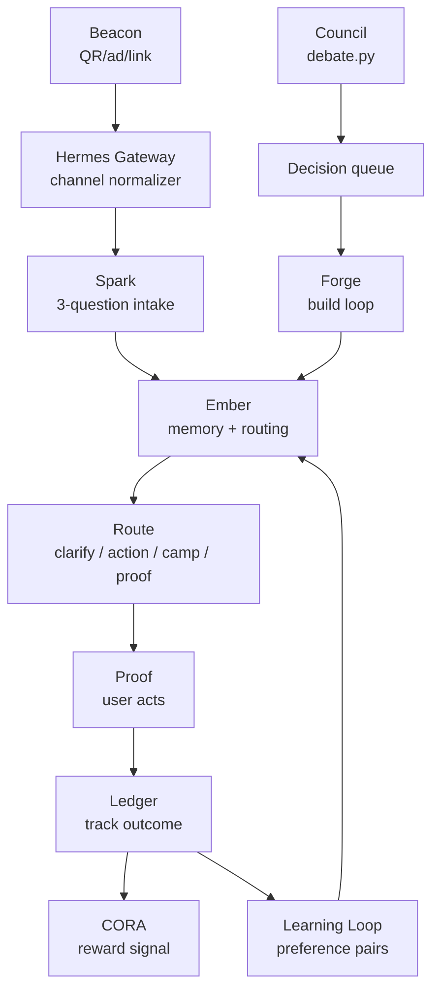

# d048 — Living Architecture Doc: auto-generated SSOT shareable with 
Auto-generated by the server build loop from answered decision d048.
## Build
There is no single canonical architecture document. Context is scattered across NOW.md, SUBSTRATE_MAP.md, REGISTRY.json, build specs, and memory files. This build creates docs/ARCHITECTURE.md — the always-current, shareable, visualizable single source of truth for how FPOS works. GPT can read it. Obsidian renders it. It auto-regenerates after every merge.

## New file: docs/ARCHITECTURE.md (the document)

Sections (in order):

### 1. What this system is (3 sentences max)
Full Potential OS: a self-evolving personal AI platform. One Chat per user, with memory, routing, CORA rewards, capability extensions. Builds itself via an autonomous loop on server 162. Laptop-free, $0 marginal.

### 2. The 9 functions (table: Name | What it does | Status | Where it lives)
Beacon    | Acquisition + attribution + content campaigns         | building (d037-d038)
Spark     | First-touch routing: 3 questions → path               | live (tgbot.py)
Ember     | Persistent memory + context steward                   | live (memory/ + tgbot.py)
Hermes    | Channel gateway: Telegram/web/SMS/WhatsApp adapters   | building (d034)
Council   | Multi-lens architecture debate → build proposals      | live (debate.py)
Forge     | Build loop: codex builds + claude review + auto-merge | live (server_build_loop.sh)
Steward   | Per-user agent: isolated namespace + profile + CORA   | building (d039-d043)
Ledger    | Ops truth ledger + cost tracking + correction signal  | live (ops_log.py + track.py)
Loop      | Self-evolution: learning signal + preference pairs    | building (d010-d023)

### 3. Data flow diagram (Mermaid — renders in GitHub, Obsidian, GPT canvas)

### 4. Build loop (end-to-end, numbered)
1. Council debates intents → proposes build → decision agent answers → queued with needs_build=true
2. Build loop (every 10 min, server 162): picks up next decision, builds with Codex ($0)
3. claude -p reviews diff (--effort high, $0) → APPROVE or REQUEST_CHANGES
4. APPROVE: auto-merges to feat/headless-build + post-merge health check
5. Health check fails: auto-reverts to pre-merge SHA
6. TG notification: verdict + 'reverse dNNN' if anything looks off

### 5. Infrastructure (table: Service | Host | What it runs)
Generated from: systemctl list-units on 162, brain_index schema, known server map
Include: sh-brain-tgbot, fpai-build-loop.timer, fpai-council.timer, fpai-morning-digest.timer
DB: brain_index on 162:25432 — tables: decisions, corrections, thread, tg_messages,
    user_channels, agent_passports, user_agents, user_profiles, beacon_campaigns

### 6. Decision queue snapshot (live — auto-populated)
Generated from: brain_index.decisions WHERE needs_build=true ORDER BY created_at
Format: | dNNN | title | status |

### 7. Key files (table: File | Purpose)
server_build_loop.sh        | autonomous build runner
tools/merge/ai_review.py    | independent code review (claude -p, effort high)
tools/council/debate.py     | architecture debate (claude -p, effort xhigh)
tools/build_loop/ops_log.py | ops truth ledger writes
tools/cost/track.py         | metered cost tracker ($20/day cap)
curator/decisions.py        | decision queue CRUD + build triggers
curator/telegram.py         | Telegram send/receive
core/STATE/NOW.md           | founder priorities (SSOT)
core/BUILD/REGISTRY.json    | what has been built

### 8. What to ask GPT / how to share
Paste this file into GPT with: 'This is the full architecture of my AI system. Help me [visualize / improve / explain / extend] it.'
Or share the GitHub link to docs/ARCHITECTURE.md (public-readable on feat/headless-build).

### 9. Gap log (honest — what is NOT live yet)
Auto-generated: query decisions WHERE needs_build=true, list as '⏳ building' or '📋 planned'

## New file: tools/docs/generate_architecture.py

Script that regenerates docs/ARCHITECTURE.md from live system state:
  1. Read core/BUILD/REGISTRY.json → populate section 2 live status
  2. Query brain_index.decisions WHERE needs_build=true → populate section 6 + gap log
  3. Run systemctl list-units on 162 → populate section 5
  4. Write docs/ARCHITECTURE.md with all sections filled
  5. Log to ops_ledger: event=architecture_generated, sections=9

Run: python3 tools/docs/generate_architecture.py
Called automatically from: server_build_loop.sh after each successful auto-merge
  (add: python3 $REPO/tools/docs/generate_architecture.py >/dev/null 2>&1 || true
   after the mark-merged line)

## Wire into server_build_loop.sh
After mark-merged call (MERGED=1 block), add:
  python3 "$REPO/tools/docs/generate_architecture.py" >/dev/null 2>&1 || true
  git -C "$REPO" add docs/ARCHITECTURE.md >/dev/null 2>&1 || true
  git -C "$REPO" commit -q -m 'docs(architecture): auto-regenerate after merge' >/dev/null 2>&1 || true
This means docs/ARCHITECTURE.md is always the live truth after every build.

## Obsidian + GPT sharing
The file is plain Markdown with a Mermaid diagram block.
Obsidian renders Mermaid natively (no plugin needed in recent versions).
GPT canvas renders Mermaid when pasted.
GitHub renders Mermaid in markdown preview.
No additional tooling required — just the file.

## Tests: tools/docs/test_generate_architecture.py
Assert all 9 sections present in output.
Assert Mermaid block present and parseable.
Assert decision queue snapshot populated from DB.
Assert gap log lists decisions with needs_build=true.
Assert script is idempotent (re-running produces same structure).
Assert server_build_loop.sh calls generate_architecture.py after merge.
New files only (except server_build_loop.sh hook — additive). Register in REGISTRY.json.
ARCHITECTURE_DISABLE=1 skips auto-regeneration.
## Context
- Question: Living Architecture Doc: auto-generated SSOT shareable with GPT + Obsidian
- Answer: requested in chat
- Proof expected: independent-AI-reviewed branch, ready for your merge
## Contract
Follow docs/codex/SESSION_CONTRACT.md. Branch off feat/headless-build (never main).
Register in core/BUILD/REGISTRY.json. Tests required. Do NOT push or merge.
