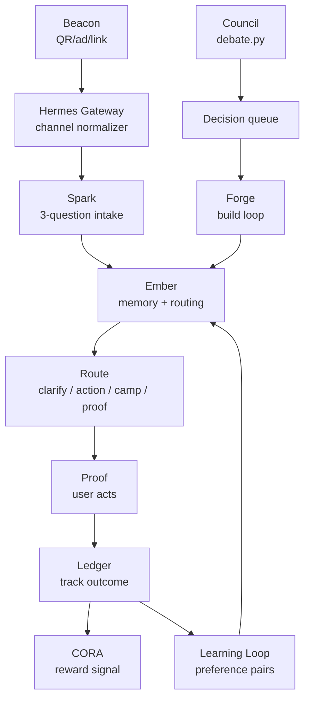

# FPOS Architecture

_Auto-generated by `tools/docs/generate_architecture.py` at 2026-06-16T19:32:18Z. Do not hand-edit; regenerate instead._

## 1. What this system is

Full Potential OS is a self-evolving personal AI platform. One Chat per user carries memory, routing, CORA rewards, and capability extensions. It builds itself through an autonomous server loop on 162: laptop-free, with $0 marginal Codex/Claude review where available.

## 2. The 9 functions

| Name | What it does | Status | Where it lives |
| --- | --- | --- | --- |
| Beacon | Acquisition + attribution + content campaigns | building (d038) | tools/beacon/ + docs/content_bank/ |
| Spark | First-touch routing: 3 questions -> path | live (tgbot.py) | SERVICES/sunheart-brain/curator/tgbot.py |
| Ember | Persistent memory + context steward | live (memory/ + tgbot.py) | memory/ + SERVICES/sunheart-brain/curator/tgbot.py |
| Hermes | Channel gateway: Telegram/web/SMS/WhatsApp adapters | building (d034) | SERVICES/*/channels/ + curator/telegram.py |
| Council | Multi-lens architecture debate -> build proposals | live (debate.py) | tools/council/debate.py |
| Forge | Build loop: Codex builds + Claude review + merge gate | live (build loop) | tools/build_loop/ + tools/merge/ |
| Steward | Per-user agent: isolated namespace + profile + CORA | building (d039-d043) | agent_passports + user_agents + user_profiles |
| Ledger | Ops truth ledger + cost tracking + correction signal | live (ops_log.py + track.py) | tools/build_loop/ops_log.py + tools/cost/track.py |
| Loop | Self-evolution: learning signal + preference pairs | building (d010, d014, d018, d021, d022, d023) | tools/learn/ + preference_pairs.jsonl |

## 3. Data flow diagram

## 4. Build loop

1. Council debates intents -> proposes build -> decision agent answers -> queued with `needs_build=true`.
2. Build loop on server 162 picks up the next decision and builds with Codex at $0 marginal cost.
3. `claude -p` reviews the diff with high effort and returns `APPROVE` or `REQUEST_CHANGES`.
4. `APPROVE` merges to `feat/headless-build` after the merge gate passes.
5. Post-merge health checks can fail closed and surface a reverse instruction.
6. Telegram notification reports the verdict and the reversal command if anything looks off.

## 5. Infrastructure

| Service | Host | What it runs |
| --- | --- | --- |
| sh-brain-tgbot | 162 | unknown - Expected on server 162; systemctl unavailable in this run |
| fpai-build-loop.timer | 162 | unknown - Expected on server 162; systemctl unavailable in this run |
| fpai-council.timer | 162 | unknown - Expected on server 162; systemctl unavailable in this run |
| fpai-morning-digest.timer | 162 | unknown - Expected on server 162; systemctl unavailable in this run |
| brain_index | 162:25432 | Postgres schema tables: decisions, corrections, thread, tg_messages, user_channels, agent_passports, user_agents, user_profiles, beacon_campaigns |

## 6. Decision queue snapshot

| dNNN | title | status |
| --- | --- | --- |
| none | No live `needs_build=true` decisions found or DB unavailable | clear |

## 7. Key files

| File | Purpose |
| --- | --- |
| server_build_loop.sh | autonomous build runner compatibility entrypoint |
| tools/build_loop/build_orchestrator.sh | autonomous build orchestrator |
| tools/merge/process_merge_requests.sh | James-approved merge processor |
| tools/merge/ai_review.py | independent code review with `claude -p` |
| tools/council/debate.py | architecture debate with `claude -p` |
| tools/build_loop/ops_log.py | ops truth ledger writes |
| tools/cost/track.py | metered cost tracker with daily cap |
| SERVICES/sunheart-brain/curator/decisions.py | decision queue CRUD + build triggers on server 162 |
| SERVICES/sunheart-brain/curator/telegram.py | Telegram send/receive |
| core/STATE/NOW.md | founder priorities SSOT |
| core/BUILD/REGISTRY.json | what has been built |

## 8. What to ask GPT / how to share

Paste this file into GPT with: "This is the full architecture of my AI system. Help me visualize / improve / explain / extend it."

Or share the GitHub link to `docs/ARCHITECTURE.md` on `feat/headless-build`. GitHub, Obsidian, and GPT canvas can render the Mermaid block directly.

## 9. Gap log

- No live `needs_build=true` gaps found, or brain_index was unavailable during generation.
